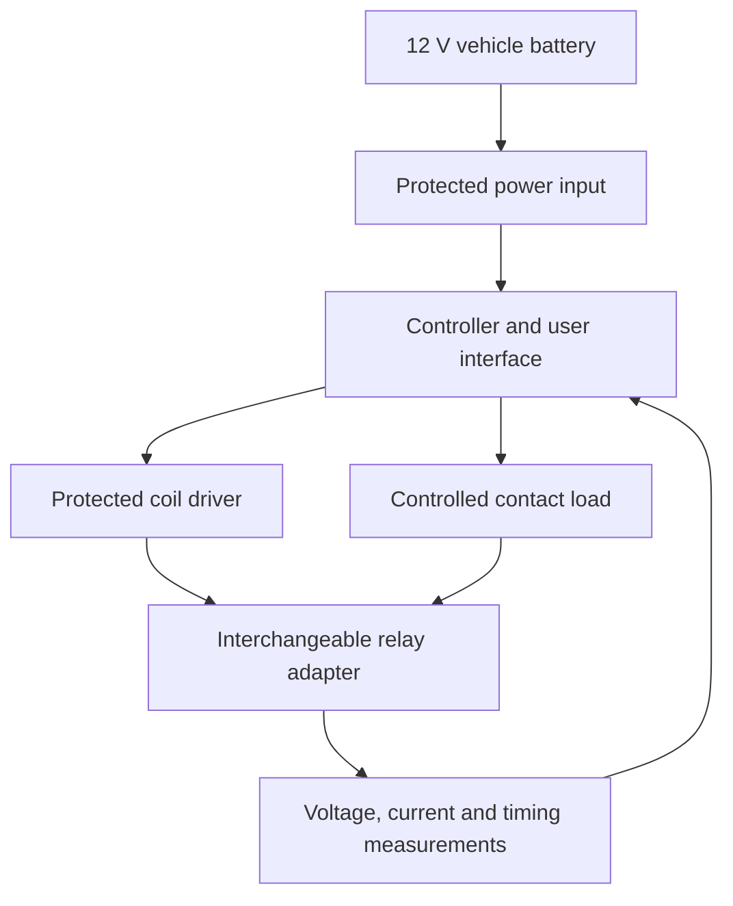

# Project 2: Universal 12 V Automotive Relay Tester

I am designing and building a universal tester for common 12 V automotive relays. My aim is to make a more useful diagnostic tool than the basic testers that only energise a relay and show a red or green light.

I want this tester to measure how the relay actually behaves. It will check the coil, identify the contact arrangement, measure switching time, cycle the relay repeatedly and test the contacts under a controlled load. I am also using interchangeable socket adapters so that I can support several relay packages without redesigning the main circuit.

> **Project status:** Early design stage. I have frozen the initial requirements and I am starting with the protected 12 V power-input circuit.

## Why I started this project

Automotive relays come in several packages and contact arrangements. A relay can still click even when its coil is abnormal, its contacts are resistive or its switching is inconsistent. I wanted to develop a tester that gives me useful measurements instead of relying only on the sound of the relay or a simple continuity indication.

This is also a learning project through which I am developing my skills in analogue electronics, embedded systems, automotive input protection, circuit simulation, PCB design, firmware development and experimental validation.

## Planned capabilities

I am designing the first version to:

- Operate from a nominal 12 V vehicle battery
- Test four-pin and five-pin automotive relays
- Support SPST normally-open, SPDT changeover and dual-87 contact arrangements
- Work with Mini ISO, Micro ISO, Maxi ISO and Denso-style packages through socket adapters
- Measure battery voltage
- Measure relay coil current and estimate coil resistance
- Detect an open or abnormally low-resistance coil
- Identify a coil suppression diode or resistor where practical
- Measure pull-in and release time
- Detect inconsistent switching over ten automatic cycles
- Check normally-open and normally-closed contacts
- Apply a controlled contact load of approximately 1 A
- Measure loaded contact voltage drop
- Show measurements and fault information on an OLED display
- Provide clear POWER, PASS and FAIL indicators

## System concept



## Initial design limits

The first version is intended for nominal 12 V plug-in electromechanical automotive relays. It is not intended to test 24 V truck relays, latching relays, solid-state relays or manufacturer-specific electronic control modules.

The controlled contact test will help me identify open, intermittent or significantly resistive contacts. It will not certify that a relay can safely carry its full advertised 20 A, 30 A or 40 A rating.

## Repository structure

```text
docs/                       Project requirements and design records
hardware/ltspice/           Circuit simulations
hardware/kicad/             Schematic and PCB design
hardware/socket-adapters/   Interchangeable relay socket designs
firmware/                   Embedded software
mechanical/                 Enclosure and mechanical drawings
test-data/                  Calibration and experimental results
references/                 Datasheet and technical-reference register
```

## Engineering records

I am documenting the calculations and reasoning behind every important design decision. This includes component ratings, safety margins, alternatives considered and the tests needed before I accept a circuit block.

- [Project specification](docs/project-specification.md)
- [Design-decision log](docs/design-decisions.md)
- [Protected power-input design](docs/power-input-design.md)
- [Relay compatibility register](docs/relay-compatibility.md)
- [Datasheet register](references/README.md)

## Development roadmap

- [x] Define the project scope and initial requirements
- [x] Register the first reference relay
- [ ] Design the protected 12 V input and logic supply
- [ ] Design the bidirectional relay-coil driver
- [ ] Design coil-current measurement and protection
- [ ] Design the loaded contact-test circuit
- [ ] Design contact voltage-drop and timing measurement
- [ ] Select and prototype the controller and display
- [ ] Develop the first socket adapter
- [ ] Simulate and bench-test each circuit block
- [ ] Capture the complete KiCad schematic
- [ ] Design and manufacture the PCB
- [ ] Develop and validate the firmware
- [ ] Design the enclosure
- [ ] Test known-good and deliberately faulty relays
- [ ] Publish the validated design and results

## Safety

I am developing this project as a bench diagnostic instrument. A vehicle battery can deliver extremely high fault current, so I will use a fuse close to the positive battery connection, reverse-polarity protection, transient suppression and staged testing with a current-limited bench supply before connecting the prototype to a vehicle battery.

The project is under development and should not be treated as a certified commercial diagnostic instrument.
