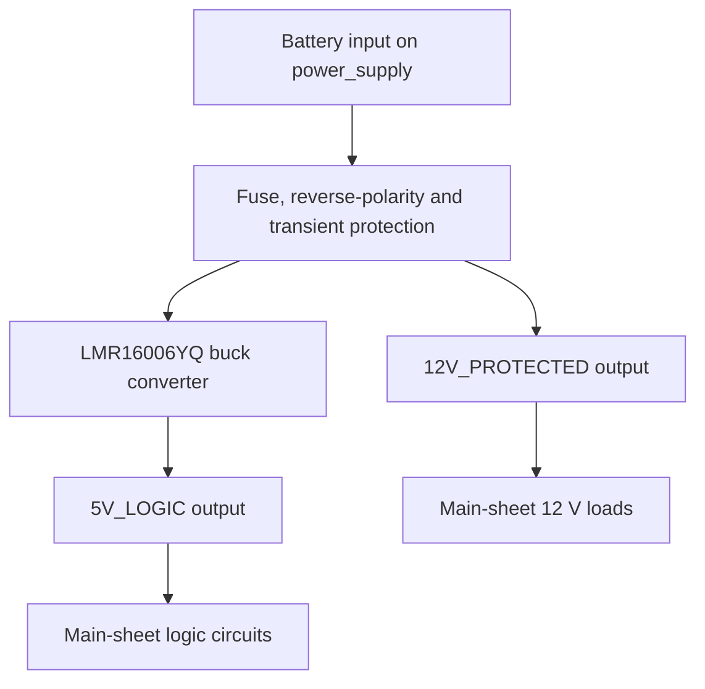

# KiCad Schematic Tutorial and Project Notes

## 1. Purpose of this guide

I am keeping this guide as my practical KiCad learning record for Project 2: the Universal 12 V Automotive Relay Tester. I will update it as the schematic, PCB and fabrication stages progress.

This guide records both **how I perform an action** and **why I perform it**. The first topic is the multi-page schematic structure that I created when the main schematic became full.

The menu wording can vary slightly between KiCad releases. These notes follow KiCad 10 terminology and the Windows interface that I used for this project.

---

## 2. What a page and hierarchy mean in KiCad

A KiCad schematic begins with one **root sheet**. I can divide a large circuit into **hierarchical subsheets**, which appear as sheet symbols on the root or another parent sheet. Each child sheet is stored as its own `.kicad_sch` file.

For this project:

- the main schematic is the root sheet;
- `power_supply` is a child sheet;
- `power_supply.kicad_sch` stores the battery protection and 5 V supply circuit;
- hierarchical labels inside the child sheet form its external interface;
- matching sheet pins on the root-sheet symbol carry those signals between the two pages.

I use hierarchy because it keeps functional blocks readable. It does not create electrical isolation. A connection exists only when the child hierarchical label and its parent sheet pin match.

---

## 3. Creating a second schematic page

### 3.1 Place the hierarchical sheet symbol

From the root schematic:

1. I press **S**, or select **Place → Add Hierarchical Sheet**.
2. I click and drag on an empty area to draw the sheet box.
3. In **Hierarchical Sheet Properties**, I enter:
   - **Sheet name:** `power_supply`
   - **File name:** `power_supply.kicad_sch`
4. I confirm the dialog and save the project.

The sheet name identifies the block in the hierarchy. The file name identifies the separate schematic file stored with the project. I use short descriptive names without spaces so that the project remains easy to navigate and version-control.

### 3.2 Open and return between sheets

- I double-click the `power_supply` sheet symbol to open the child sheet.
- I use the hierarchy navigator, or return to the root sheet through the sheet-navigation controls, to go back to the main schematic.

I save after creating the sheet because the root schematic now depends on the child `.kicad_sch` file. Both files must be kept together and committed to GitHub.

---

## 4. Creating the child-sheet interface

### 4.1 Place hierarchical labels inside the child sheet

A normal local label only connects matching nets **within the same sheet**. To carry a signal through the sheet boundary, I use a **hierarchical label**.

Inside `power_supply.kicad_sch`:

1. I select **Place Hierarchical Label** from the right toolbar.
2. I enter the required net name.
3. I select the label shape.
4. I place the label directly on the wire that must leave the child sheet.

For the completed Project 2 power sheet, the interface is:

| Hierarchical label | Child-sheet role | Shape | Root-sheet destination |
|---|---|---|---|
| `12V_PROTECTED` | Protected 12 V produced after the battery-input protection stage | Output | Relay coil, contact-load supply and battery-voltage measurement |
| `5V_LOGIC` | Regulated logic supply produced by the LMR16006YQ buck converter | Output | ATmega4809, sensors, OLED, LEDs and buzzer circuitry |

The direction is described from the **child sheet's point of view**. Therefore, a rail generated inside `power_supply` and sent to the main page is an **Output**.

KiCad calls Input, Output, Bidirectional, Tri-state and Passive the pin or label **shape**. I keep the shapes consistent because the Sync Sheet Pins tool uses both the name and the shape when deciding whether a label and pin match.

### 4.2 Naming rules I follow

- The hierarchical label and sheet pin use exactly the same spelling.
- I keep capitalisation and underscores consistent.
- I use functional names such as `5V_LOGIC`, not vague names such as `POWER2`.
- I do not use an ordinary local label as a substitute for the child-to-parent hierarchical connection.
- I avoid placing text over the connection point, because visual overlap can hide an unwired pin.

---

## 5. Importing the matching sheet pins

Hierarchical labels are created inside the child sheet first. I then expose them as pins on the child-sheet symbol in the parent sheet.

From the root schematic:

1. I right-click the border of the `power_supply` sheet symbol.
2. I select **Place Sheet Pin** or **Import Sheet Pins**, depending on the wording shown by the installed KiCad version.
3. KiCad attaches the first unmatched hierarchical label to the cursor.
4. I click on the sheet-symbol border to place it.
5. I repeat until `12V_PROTECTED` and `5V_LOGIC` are both visible.
6. I press **Esc** to finish.

I place inputs on the left and outputs on the right when practical. This is a drawing convention that makes signal flow easier to understand.

---

## 6. Wiring the imported pins on the root sheet

A sheet pin is only the interface point. I must still connect it to the intended root-sheet net.

For each imported pin:

1. I hover over the small electrical connection square.
2. I press **W** to begin a wire.
3. I draw a short wire away from the sheet symbol.
4. I press **L** to place an ordinary local label on that root-sheet wire.
5. I give the root net the required name, such as `12V_PROTECTED` or `5V_LOGIC`.
6. I zoom in and confirm that the wire touches the sheet-pin connection square.

Because these root-sheet labels are on the same page as the circuits they supply, matching local labels connect those root-sheet nets without requiring long wires across the drawing.

---

## 7. Checking and synchronising the hierarchy

After adding, renaming or changing a hierarchical label:

1. I right-click the child-sheet symbol on the parent sheet.
2. I select **Sync Sheet Pins**.
3. I check that each hierarchical label has one matching sheet pin.
4. I resolve unmatched labels or obsolete pins.
5. I confirm that the names and shapes match.

A green matched status means that KiCad has paired the child labels and parent pins correctly. It does not prove that every external wire is connected correctly, so I still inspect the wiring and run ERC.

---

## 8. Common mistakes

| Mistake | Result | Correction |
|---|---|---|
| Using a local label inside the child sheet | The signal does not appear as a parent sheet pin | Replace it with a hierarchical label |
| Importing pins before creating child labels | KiCad has no defined child interface to import | Create the hierarchical labels first |
| Different pin and label names | The pair remains unmatched | Use identical names |
| Different label and pin shapes | Sync Sheet Pins reports a mismatch | Make both shapes consistent |
| Choosing direction from the root sheet's viewpoint | Input/output labels become confusing | Define direction from the child sheet's viewpoint |
| Drawing near a pin without touching its square | The connection looks close but remains open | Start the wire directly from the connection square |
| Moving only the displayed text | The electrical anchor may remain elsewhere | Check the wire endpoint and connection marker |
| Forgetting the child schematic file in Git | The root sheet references a missing page on another computer | Commit the root and child `.kicad_sch` files together |

---

## 9. Project 2 hierarchy used in this design

The `power_supply` sheet is responsible for accepting the raw battery connection and producing the two rails used by the rest of the tester. This creates a clear dependency: the main-sheet circuitry depends on the two output pins of the power-supply child sheet.

---

## 10. Final checklist

Before I consider a new hierarchical page complete, I verify:

- the child sheet has a descriptive sheet name and filename;
- the child `.kicad_sch` file is saved;
- every cross-sheet signal uses a hierarchical label;
- every child label has a matching parent sheet pin;
- label and pin names match exactly;
- label and pin shapes match;
- each parent pin is wired to the intended root net;
- power and ground conventions are consistent;
- the hierarchy is checked with **Sync Sheet Pins**;
- ERC is run after the circuit is complete;
- all related schematic files are committed together.

---

## 11. Official reference

- [KiCad 10 Schematic Editor documentation — hierarchical schematics and sheet pins](https://docs.kicad.org/10.0/en/eeschema/eeschema.html)
- [KiCad 10 Introduction — schematic sheets and hierarchy](https://docs.kicad.org/10.0/en/introduction/introduction.html)

I will extend this guide later with symbol selection, component fields, annotation, footprint assignment, ERC, PCB transfer, layout, DRC and fabrication-output checks.
