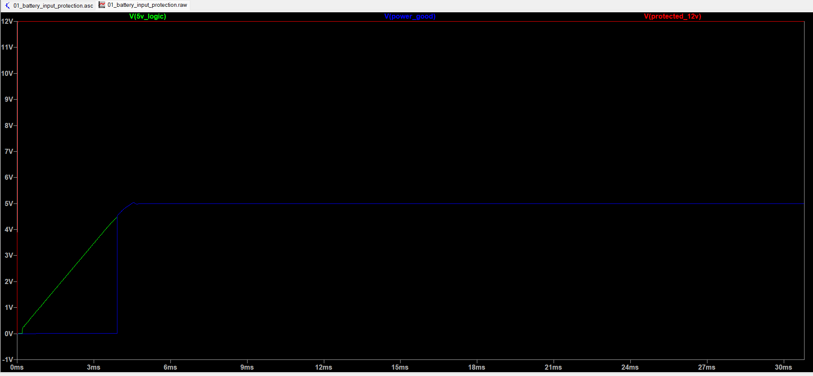

# Simulation 01 — Protected Input and 5 V Logic Supply

**Date:** 21 July 2026  
**LTspice schematic shown in the result:** `01_battery_input_protection.asc`  
**Analysis:** `.tran 50m startup`  
**Input:** 12 V nominal DC  
**Temporary 5 V load:** 100 Ω, approximately 50 mA  
**Status:** The nominal-input start-up simulation behaved as expected.

## What I tested

I combined the protected 12 V input with an LT8610 synchronous buck converter. The purpose of this run was to check that the protected battery rail remained at 12 V, the new `5V_LOGIC` rail started in a controlled way and the `POWER_GOOD` signal did not indicate a valid supply before the 5 V output was close to regulation.

## What the waveform shows

| Trace | Simulated result | Interpretation |
|---|---:|---|
| `V(PROTECTED_12V)` — red | Approximately 12 V | The correctly connected battery reaches the protected rail through Q1. The MOSFET drop is too small to see at this plot scale and light load. |
| `V(5V_LOGIC)` — green | Smooth ramp to approximately 5.0 V in about 4.5 ms | The LT8610 feedback loop regulates the output and the 10 nF `TR/SS` capacitor deliberately controls start-up. |
| `V(POWER_GOOD)` — blue | Low during most of the ramp; rises at about 4 ms and settles near 5 V | The open-drain `PG` output is released only when the output is close to its target. The 100 kΩ pull-up then raises the signal to the 5 V rail. |

The simulation therefore confirms the intended sequence:

1. The protected 12 V input becomes available.
2. The LT8610 raises the logic supply gradually instead of applying an abrupt 5 V step.
3. `POWER_GOOD` remains low while the output is below its valid window.
4. `POWER_GOOD` becomes high shortly before the output completes its ramp to 5 V.

This is useful because the future ATmega4809 can keep relay-control outputs in a safe state until the regulator reports that its supply is valid.

## Why the output is close to 5 V

The LT8610 regulates its FB pin to approximately 0.97 V. I used a 1 MΩ upper feedback resistor and a 243 kΩ lower resistor:

\[
V_{OUT}=0.97\left(1+\frac{1\,000\,000}{243\,000}\right)
=4.96\text{ V}
\]

The small difference from exactly 5.00 V is intentional and agrees with the waveform. Resistor tolerance, feedback-reference tolerance, PCB leakage and temperature will affect the physical output, so I will later repeat the calculation with worst-case values.

## Why the start-up takes about 4.4 ms

The LT8610 supplies approximately 2.2 µA into the 10 nF soft-start capacitor. A first-order estimate is:

\[
t_{SS}\approx\frac{V_{FB}C_{SS}}{I_{SS}}
=\frac{0.97\times10\text{ nF}}{2.2\text{ µA}}
=4.41\text{ ms}
\]

The plotted 5 V ramp reaches regulation in roughly 4.5 ms, which agrees closely with this estimate. Soft-start reduces sudden output-capacitor charging current and gives the controller supply a predictable rise.

## Why `POWER_GOOD` changes near 4.5 V

The LT8610 datasheet states that `PG` indicates when the output is within approximately ±9% of its programmed value. The rising threshold is therefore expected near:

\[
V_{PG,rise}\approx0.91\times4.96=4.51\text{ V}
\]

The blue trace rises when the green trace is around 4.5–4.6 V, so its timing is consistent with the datasheet model. The nearly vertical blue edge is not a second power rail starting; it is the regulator's open-drain status transistor releasing the `POWER_GOOD` node.

## 5 V current allowance

I made an initial current budget for the logic rail:

| Planned load | Design allowance |
|---|---:|
| ATmega4809 and local decoupling | 25 mA |
| OLED display | 35 mA |
| Buzzer | 40 mA |
| LEDs and buttons | 30 mA |
| Measurement and interface circuits | 40 mA |
| Expansion and design margin | 80 mA |
| **Initial design estimate** | **250 mA** |

I will design the physical 5 V rail for at least 500 mA continuous capacity. The relay coil and the 1 A contact-test load are supplied from the protected 12 V path, so they are not included in this logic-rail budget.

The temporary 100 Ω simulation load represents:

\[
I_{LOAD}=\frac{4.96}{100}=49.6\text{ mA}
\]

and dissipates approximately:

\[
P=\frac{4.96^2}{100}=0.246\text{ W}
\]

If I reproduce this load physically, I will use at least a 0.5 W resistor or an electronic load rather than operating a 0.25 W resistor continuously at its nominal rating.

## Component choices and functions

### Protected 12 V input

| Reference/value | Function | Why I selected it or how I rated it |
|---|---|---|
| Q1 — RSS060P05 model | High-side reverse-polarity protection | It is a −45 V P-channel MOSFET with a maximum stated 36 mΩ on-resistance at \(V_{GS}=-10\text{ V}\). At the earlier 1.4 A design estimate, the first-order loss is only \(1.4^2\times0.036=0.071\text{ W}\), much lower than a series diode. The RSS060P05HZG remains the physical automotive-grade candidate. |
| R1 — 10 kΩ | Pulls Q1 gate toward ground | It creates the negative \(V_{GS}\) needed to turn on the P-channel MOSFET during correct polarity while limiting gate-clamp current during a transient. |
| D2 — EDZV12B | Limits Q1 gate-to-source voltage | The approximately 12 V Zener clamp keeps \(|V_{GS}|\) below Q1's ±20 V absolute maximum. It protects the MOSFET gate, not the complete supply rail. |
| D1 — SMCJ18A | Clamps positive input transients | Its 18 V standoff is above the intended 10–16 V operating range. Its stated maximum clamp of 29.2 V is below the 42 V input limit of the LT8610 and the 45 V rating of Q1, although physical pulse and layout validation are still required. |
| 100 nF, 50 V | High-frequency input bypass | The small ceramic capacitor has low parasitic inductance and responds to faster noise than the bulk capacitor. |
| 47 µF, 50 V | Local bulk input capacitor | It supports slower load changes and reduces rail movement. The 50 V rating gives \(50/29.2=1.71\), or approximately 71% voltage margin over the TVS data-sheet clamp value. |

### LT8610 5 V buck converter

| Component or pin | Function | Selection reasoning |
|---|---|---|
| U1 — LT8610 | Converts `PROTECTED_12V` to `5V_LOGIC` | Its 3.4–42 V operating/input capability and 2.5 A output capability give ample electrical headroom for the estimated 250 mA logic load. A buck converter avoids the heat that a linear 7805 would generate. At 12 V and 250 mA, an idealised 7805 loss would be \((12-5)\times0.25=1.75\text{ W}\). |
| `EN/UV` to `PROTECTED_12V` | Enables the regulator whenever protected input power exists | This is simple for the first prototype. A resistor divider can later add a deliberate battery undervoltage threshold if testing requires it. |
| `CIN` — 4.7 µF, X7R, 50 V | Local switching-current reservoir | The buck converter draws fast pulsed input current. This capacitor must sit directly beside `VIN` and `PGND`; the more distant 47 µF input capacitor cannot replace it at high frequency. |
| `RRT` — 60.4 kΩ | Sets switching frequency | The LT8610 datasheet specifies a typical 700 kHz oscillator frequency with 60.4 kΩ. This is the manufacturer's published 5 V reference choice. |
| `CSS` — 10 nF | Programs soft-start | The calculated ramp time is approximately 4.41 ms, matching the simulated result. |
| `SYNC` to ground | Selects low-ripple Burst Mode operation | It prevents the pin floating and supports good light-load efficiency. I may reconsider the operating mode later if measurement noise becomes important. |
| `CVCC` — 1 µF | Decouples `INTVCC` | It stabilises the IC's internal supply and must be placed close to the pin. `INTVCC` will not power external circuits. |
| `CBST` — 100 nF | Bootstrap capacitor between `BST` and `SW` | It provides the floating drive supply used by the internal high-side switch. It connects to `SW`, not to ground. |
| L1 — 4.7 µH | Stores and transfers switching energy | This value is used in the manufacturer's 5 V, 700 kHz reference circuit. The physical part still needs a saturation-current rating above the worst-case switch/inductor peak current, suitable RMS-current rating and low DCR. |
| `COUT` — 47 µF | Filters the switched inductor current | It reduces output ripple and supports load steps. For the PCB I must account for ceramic-capacitor DC-bias derating, tolerance and ESR rather than trusting the printed 47 µF value alone. |
| 1 MΩ and 243 kΩ | Feedback divider | These values calculate to approximately 4.96 V from the 0.97 V feedback reference. |
| `CFF` — 10 pF | Phase-lead/feed-forward capacitor | It is connected across the 1 MΩ upper feedback resistor, as in the manufacturer's reference circuit, to improve high-frequency feedback behaviour and transient response. It must not connect to the `SW` node. |
| `BIAS` to `5V_LOGIC` | Supplies internal circuitry from the regulated output after start-up | This reduces the voltage dropped internally from the 12 V input and improves efficiency. |
| `RPG` — 100 kΩ | Pulls the open-drain `PG` output up to 5 V | It produces the `POWER_GOOD` logic signal while drawing only about \(5/100\,000=50\text{ µA}\) when low. |
| 100 Ω temporary load | Represents a 49.6 mA logic load | It gives the first simulation a defined, modest load. It is not the final product load. |

## What this simulation proves—and what it does not

This run supports the following conclusions under the models and nominal values used:

- the protected rail supplies the buck regulator at approximately 12 V;
- the feedback divider produces approximately 5 V;
- soft-start timing agrees with the component calculation;
- the power-good output changes state at a sensible output voltage;
- the circuit reaches a stable nominal operating point with a 50 mA load.

It does **not** yet prove:

- physical efficiency or temperature rise;
- output ripple with real capacitor ESR, ESL and DC-bias derating;
- inductor saturation margin;
- stability across all loads and component tolerances;
- start-up at 10 V and operation at 16 V;
- response to rapid load changes;
- behaviour during cranking dips, jump-start voltage or standard automotive pulses;
- EMC performance or formal automotive compliance.

The LTspice `.asc` source file was not included with the waveform supplied for this record. I need to export and commit that file from the design computer so another person can rerun the exact circuit rather than relying only on this screenshot and description.

## Next simulation checks

Before I freeze the power section, I will run and record:

1. A 10 V, 12 V, 14.4 V and 16 V input sweep.
2. A 50 mA to 250 mA load step and a 500 mA design check.
3. Output ripple with a short maximum timestep.
4. Inductor peak current and switch current.
5. Regulator input current and calculated efficiency.
6. Power-good timing during start-up, input interruption and output overload.
7. Worst-case feedback-resistor and capacitor tolerances.
8. A repeat run after selecting real capacitor and inductor part numbers.

## Primary references

- [Analog Devices LT8610 product page](https://www.analog.com/en/products/lt8610.html)
- [Analog Devices LT8610 data sheet, Rev. D](https://www.analog.com/media/en/technical-documentation/data-sheets/lt8610.pdf)
- [Microchip ATmega4808/4809 complete data sheet](https://ww1.microchip.com/downloads/en/DeviceDoc/ATmega4808-09-DataSheet-DS40002173C.pdf)

