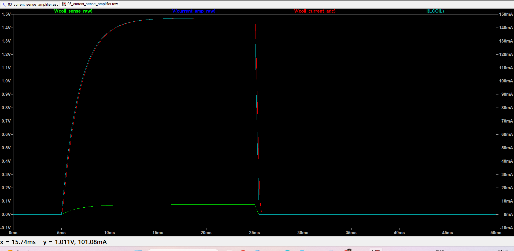

# Simulation 03: nominal relay-coil current measurement

## Purpose

I used this simulation to check that the relay-coil shunt voltage can be amplified and filtered into a useful signal for the ATmega4809 ADC. This is a nominal simulation using a representative relay coil; it is not yet a measurement of the physical relay.



## Circuit represented

I retained the protected 12 V input, LT8610 5 V supply and equivalent high-side relay driver from the earlier stages. The current-measurement section uses:

| Item | Simulation value | Purpose |
|---|---:|---|
| Relay resistance | 80 Ω | Representative coil winding resistance |
| Relay inductance | 150 mH | Representative coil magnetic behaviour |
| Equivalent switch on-resistance | 1 Ω | Approximation of the smart high-side switch power path |
| Current shunt | 0.5 Ω, 1% | Converts coil current to a small voltage |
| Current-sense gain | 20 V/V | Represents the INA180A1-Q1 nominal gain |
| ADC series resistor | 1 kΩ | Isolates the amplifier and forms the ADC filter |
| ADC capacitor | 100 nF | Filters switching noise |
| INA supply bypass | 100 nF | Local decoupling for the physical amplifier |

The amplifier is represented by this simulation-only behavioural source:

```spice
V=limit(20*V(COIL_SENSE_RAW),0,4.97)
```

It models nominal gain and output limiting, but not offset, bandwidth, gain tolerance, temperature drift or the complete output-swing behaviour of a real INA180A1-Q1.

## Expected nominal values

The series resistance while the relay is energised is:

```math
R_{total}=80+1+0.5=81.5\ \Omega
```

The expected steady-state coil current is:

```math
I_{coil}=\frac{12}{81.5}=0.1472\ \text{A}
```

The expected shunt voltage is:

```math
V_{shunt}=I_{coil}R_{shunt}
=(0.1472)(0.5)=73.6\ \text{mV}
```

With a gain of 20 V/V:

```math
V_{amp}=20V_{shunt}=1.472\ \text{V}
```

## ADC filter

The 1 kΩ and 100 nF filter has:

```math
\tau=RC=(1000)(100\ \text{nF})=100\ \mu\text{s}
```

```math
f_c=\frac{1}{2\pi RC}=1.59\ \text{kHz}
```

Its approximate 10–90% response time is 220 µs. This is much shorter than the approximately 1.84 ms electrical time constant of the representative coil, which is why `CURRENT_AMP_RAW` and `COIL_CURRENT_ADC` almost overlap in the full-scale plot.

With a 5 V, 10-bit ADC reference, the nominal 1.472 V output corresponds to approximately:

```math
ADC_{code}=\frac{1.472}{5}\times1023\approx301
```

The nominal conversion scale is approximately 0.489 mA per ADC count before calibration.

## Result

The completed 0–50 ms waveform agrees with the calculated nominal behaviour:

| Signal | Simulated result | Expected |
|---|---:|---:|
| `I(LCOIL)` | ≈147 mA | 147.2 mA |
| `COIL_SENSE_RAW` | ≈74 mV | 73.6 mV |
| `CURRENT_AMP_RAW` | ≈1.47 V | 1.472 V |
| `COIL_CURRENT_ADC` | ≈1.47 V | 1.472 V after settling |

The relay command is active from approximately 5 ms to 25 ms. The coil current rises exponentially, the shunt voltage follows it, and the amplified signal remains inside the nominal 0–5 V ADC range. The filtered ADC signal shows only a small delay because the filter time constant is short relative to the coil-current change.

## What this simulation proves

This run supports the following nominal design decisions:

- a 0.5 Ω shunt produces a measurable voltage without materially reducing coil current;
- a gain of 20 V/V converts the representative healthy-coil current to approximately 1.47 V;
- the 1 kΩ and 100 nF ADC filter preserves the coil-current response while reducing high-frequency noise;
- the nominal amplified signal is suitable for a 5 V ATmega4809 ADC input.

## What it does not yet prove

This simulation does not yet establish:

- actual relay resistance or inductance;
- INA180A1-Q1 offset, gain error, temperature drift or output swing;
- ADC reference accuracy, PCB noise or Kelvin-shunt routing performance;
- open-coil and abnormally low-resistance thresholds;
- behaviour at the smart switch current limit;
- safe automatic identification of relays containing an internal suppression diode;
- performance under vehicle transients or physical bench conditions.

The current single-polarity driver simulation is only the nominal energising path. I still need a deliberate polarity-detection or bidirectional-drive strategy before claiming universal compatibility with diode-suppressed coils.

## Next tests

I will next simulate open-coil, normal-coil and low-resistance-coil cases and define conservative firmware thresholds. I will then include component tolerances and verify that the current-limit and ADC ranges remain safe.

The editable `03_current_sense_amplifier.asc` source is being maintained on the design computer and should be committed separately so this result can be reproduced directly from the repository.

## References

- [TI INA180-Q1 product page and data sheet](https://www.ti.com/product/INA180-Q1)
- [TI TPS1H000-Q1 product page and data sheet](https://www.ti.com/product/TPS1H000-Q1)
- [Microchip ATmega4809 product page and data sheet](https://www.microchip.com/en-us/product/atmega4809)
