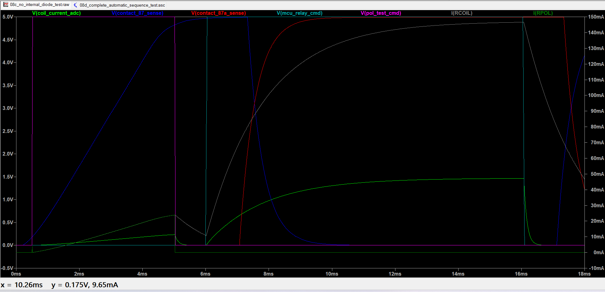

# Simulation 08d: complete automatic relay-test sequence

## Purpose

I used this simulation to check that the separate relay-tester functions can operate in the same sequence without interfering with each other. The run represents the order I intend the ATmega4809 firmware to follow:

1. apply a low-current polarity pre-check;
2. leave a short safety gap;
3. energise the relay coil from the protected 12 V rail;
4. measure coil current;
5. verify the terminal 87 normally-open contact and terminal 87a normally-closed contact;
6. switch the coil off and confirm that the contacts return.

I performed this combined test because a circuit block can work on its own but still fail when its timing overlaps another block. In particular, I needed to show that the low-current check does not pull in the relay, that the full-power command is delayed until the pre-check ends, and that the contact sensing works during both pull-in and release.



## Model and settings used

This is a nominal simulation of a five-pin changeover relay with a correctly oriented internal suppression diode.

| Item | Simulation value | Why it is included |
|---|---:|---|
| Relay-coil resistance | 80 Ω | Representative nominal 12 V automotive-relay coil |
| Relay-coil inductance | 150 mH | Represents the coil-current rise and decay |
| Equivalent main-switch resistance | 1 Ω | Approximates the protected high-side driver path |
| Current shunt | 0.5 Ω | Converts total coil current into a measurable voltage |
| Current-sense gain | 20 V/V | Produces the `COIL_CURRENT_ADC` signal |
| Polarity-test resistor, `RPOL` | 100 Ω | Limits the pre-check current so the relay does not operate |
| Polarity-path blocking diode | 1N5819 | Prevents the 12 V coil rail feeding back into the 5 V logic rail |
| NO closing threshold | Coil current above 80 mA | Idealised model of terminal 87 closing |
| NC opening threshold | Coil current above 70 mA | Creates a small break-before-make interval |
| Contact ADC filters | 4.7 kΩ and 100 nF | Filters switching noise before the MCU inputs |
| Transient command | `.tran 18m startup` | Keeps the run short while showing energisation and release |

The contact-filter time constant is:

```math
\tau_{contact}=RC=(4.7\ \text{k}\Omega)(100\ \text{nF})=470\ \mu\text{s}
```

The representative coil time constant during energisation is approximately:

```math
\tau_{coil}=\frac{L}{R}
=\frac{150\ \text{mH}}{80+1+0.5}
\approx1.84\ \text{ms}
```

The calculated steady coil current is:

```math
I_{coil}=\frac{12}{80+1+0.5}
\approx147.2\ \text{mA}
```

The corresponding current-sense output is:

```math
V_{ADC}=I_{coil}(0.5)(20)
\approx1.47\ \text{V}
```

## Signals plotted

| Trace | Meaning |
|---|---|
| `V(POL_TEST_CMD)` | Command that enables the low-current polarity-test path |
| `I(RPOL)` | Current supplied by the polarity-test path |
| `V(MCU_RELAY_CMD)` | Scripted command that requests full 12 V coil power |
| `I(RCOIL)` | Current through the representative relay coil |
| `V(COIL_CURRENT_ADC)` | Amplified coil-current signal for the MCU ADC |
| `V(CONTACT_87_SENSE)` | Filtered normally-open terminal 87 input |
| `V(CONTACT_87A_SENSE)` | Filtered normally-closed terminal 87a input |

## Reading the waveform

| Approximate time | What happens | Evidence in the graph |
|---:|---|---|
| 0–0.5 ms | The simulated rails start up. | Terminal 87 sense begins charging towards 5 V. This start-up transition is not a relay fault. |
| 0.5–5 ms | The polarity pre-check is active. | `POL_TEST_CMD` is high, `I(RPOL)` and coil current rise to about 24 mA, and `COIL_CURRENT_ADC` reaches about 0.23 V. |
| 0.5–5 ms | The relay must remain released. | The pre-check current stays well below the 70 mA and 80 mA contact thresholds; terminal 87 remains high and terminal 87a remains low. |
| 5–6 ms | A safety gap separates the two tests. | The polarity command is off before the main relay command turns on. |
| 6–16 ms | Full coil energisation is active. | `MCU_RELAY_CMD` is high, coil current rises exponentially to about 147 mA, and `COIL_CURRENT_ADC` approaches about 1.47 V. |
| About 7–10 ms | The changeover contacts operate. | Terminal 87a sense rises towards 5 V after the NC path opens, while terminal 87 sense falls towards 0 V after the NO path closes. |
| After 16 ms | The main command turns off. | Coil current and `COIL_CURRENT_ADC` decay. Terminal 87 sense begins returning high and terminal 87a sense begins returning low. |

The contact-sense traces are intentionally rounded. Each 4.7 kΩ–100 nF input filter needs approximately five time constants, or 2.35 ms, to settle closely to its final value:

```math
5\tau_{contact}=5(470\ \mu\text{s})=2.35\ \text{ms}
```

The relay command ends at about 16 ms, while the simulation ends at 18 ms. The graph therefore shows the correct release directions, but the two filtered contact signals are still settling at the right edge of the plot. This is expected and is not evidence of a failed release.

## Result and acceptance

I accept this waveform as the nominal functional proof of the combined sequence because:

- the polarity pre-check occurs before full coil power;
- the pre-check current is limited to about 24 mA and does not operate the contacts;
- the full-power coil current reaches the calculated value of about 147 mA;
- the ADC signal reaches the expected value of about 1.47 V;
- terminals 87 and 87a change to the correct opposite states when the coil is energised;
- both contact-sense signals reverse direction after the coil is switched off;
- the command stages do not overlap.

This result means the essential nominal LTspice functional sequence is complete. I can now use it as the behavioural reference when assigning the ATmega4809 pins and writing the firmware state machine.

## What this simulation does not yet prove

This run is not a final validation of the physical tester. In particular:

- `MCU_RELAY_CMD` and `POL_TEST_CMD` are scripted voltage sources; a real MCU decision based on measured thresholds is not yet implemented;
- the 70 mA and 80 mA contact thresholds and ideal switches simplify real relay mechanics, delay and contact bounce;
- the 80 Ω and 150 mH coil values represent one nominal relay model rather than the full supported relay range;
- the run does not include component tolerances, temperature effects, ADC error, PCB noise or wiring resistance;
- it does not apply the planned 1 A loaded-contact test or measure contact voltage drop;
- it does not prove automotive-transient compliance or safe operation from a real vehicle battery;
- physical bench testing is still required before I freeze the PCB and firmware thresholds.

The earlier polarity runs showed different pre-check signatures for a correctly oriented diode, a reversed internal diode and a relay without an internal diode. The MCU design must use conservative bands with an invalid region between them rather than copying ideal LTspice values as exact pass/fail limits.

## Next design step

My next step is the actual ATmega4809 circuit. I will replace the scripted command sources with GPIO pins, connect `COIL_CURRENT_ADC` and the two contact-sense signals to appropriate inputs, add decoupling and UPDI programming, and then translate this sequence into a firmware state machine.
